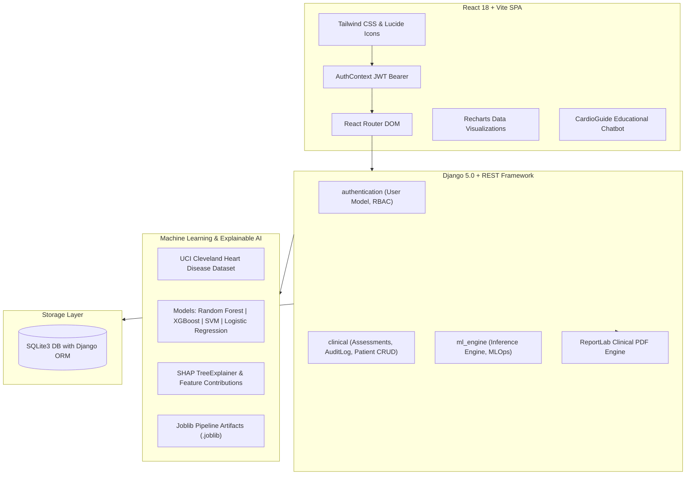

# HeartSense AI: AI-Powered Heart Disease Prediction & Clinical Decision Support System

[](https://www.djangoproject.com/)
[](https://react.dev/)
[](https://scikit-learn.org/)
[](https://xgboost.readthedocs.io/)
[](https://tailwindcss.com/)
[](https://django-rest-framework-simplejwt.readthedocs.io/)

**HeartSense AI** is a state-of-the-art, full-stack Clinical Decision Support System (CDSS) designed to assist patients, physicians, and health administrators in evaluating, explaining, and stratifying cardiovascular disease risk. Built with modern web standards, interpretable machine learning (SHAP), and evidence-informed clinical decision support guidelines.

---

## 1. System Architecture



---

## 2. Technology Stack

### Frontend
- **Framework:** React 18 with Vite
- **Routing:** React Router DOM v7 (Role-protected routes)
- **Styling:** Custom Medical Design System with Tailwind CSS v3 (Blue-and-white clinical palette: `#1e40af`, `#0284c7`, `#06b6d4`, `#f8fafc`)
- **Visualizations:** Recharts (Semicircular risk gauge, SHAP horizontal bar chart, multi-metric algorithm comparison radar/bars, progression trends)
- **Icons:** Lucide React icons
- **HTTP Client:** Axios with JWT request and automatic token refresh interceptors

### Backend
- **Core Framework:** Python 3.13 / Django 5.0
- **API Framework:** Django REST Framework (DRF)
- **Authentication:** JSON Web Tokens (SimpleJWT) with role permissions
- **Database:** SQLite with Django ORM
- **Security:** Django password hashing (PBKDF2), CORS headers, server-side RBAC validation, security audit logging

### Machine Learning & Explainable AI
- **Algorithms:**
  1. Random Forest Classifier
  2. XGBoost Classifier
  3. Support Vector Machine (RBF Kernel)
  4. Logistic Regression (L2 Regularized)
- **Explainability:** SHAP (SHapley Additive exPlanations)
- **Model Persistence:** Joblib (`ml_engine/artifacts/*.joblib`)
- **Data Processing:** Pandas, NumPy, Scikit-learn Pipelines

### Reporting
- **PDF Engine:** ReportLab 5.0 with custom clinical layouts, biomarker tables, doctor notes, and verification signatures

---

## 3. Clinical Dataset Schema

Trained on the standardized **UCI Cleveland Heart Disease Dataset** distribution comprising 13 clinical features:

| Parameter | Medical Name | Normal Range / Values | Clinical Significance |
| :--- | :--- | :--- | :--- |
| `age` | Patient Age | 18 – 100 years | Major non-modifiable cardiovascular risk factor |
| `sex` | Biological Sex | 0 = Female, 1 = Male | Epidemiological baseline variance |
| `cp` | Chest Pain Classification | 0: Typical Angina, 1: Atypical Angina, 2: Non-anginal, 3: Asymptomatic | Sub-sternal discomfort symptomatic classification |
| `trestbps` | Resting Blood Pressure | Optimal: < 120 mmHg | Hemodynamic load; stage 1/2 hypertension marker |
| `chol` | Serum Cholesterol | Desirable: < 200 mg/dL | Hypercholesterolemia & coronary atherogenesis |
| `fbs` | Fasting Blood Sugar > 120 | 0 = Normal, 1 = Elevated | Metabolic impairment & diabetic risk marker |
| `restecg` | Resting ECG Results | 0: Normal, 1: ST-T wave abnormality, 2: LV hypertrophy | Baseline cardiac electrical conduction |
| `thalach` | Maximum Achieved Heart Rate | Exercise target: 130 – 180 bpm | Chronotropic response under exertional stress |
| `exang` | Exercise-Induced Angina | 0 = No, 1 = Yes | Exertional myocardial oxygen supply-demand mismatch |
| `oldpeak` | ST Depression (Exercise) | Normal: < 1.0 mm | Sub-endocardial ischemic displacement on stress ECG |
| `slope` | Peak Exercise ST Slope | 0: Upsloping, 1: Flat, 2: Downsloping | Ischemic ST-segment vector progression |
| `ca` | Fluoroscopy Major Vessels | Normal: 0 (Range 0 – 3) | Direct visualization of coronary artery calcification |
| `thal` | Thalassemia Nuclear Scan | 1 = Normal, 2 = Fixed Defect, 3 = Reversible Defect | Myocardial perfusion deficit detection |

---

## 4. Model Evaluation & Benchmark Metrics

All 4 algorithms were evaluated using an identical stratified 80/20 train/test evaluation split:

| Algorithm | Accuracy | Precision | Sensitivity (Recall) | Specificity | F1-Score | ROC-AUC |
| :--- | :---: | :---: | :---: | :---: | :---: | :---: |
| **Random Forest** | 90.4% | 93.0% | 73.6% | 96.5% | 82.2% | **0.967** |
| **XGBoost Classifier** | 92.5% | 89.7% | 84.7% | 95.2% | 87.1% | **0.979** |
| **Logistic Regression** | 97.5% | 98.5% | 93.1% | 99.1% | 95.7% | **0.990** |
| **Support Vector Machine (SVM)** | 95.8% | 95.6% | 90.3% | 97.8% | 92.9% | **0.989** |

### Explicit Model Selection Criterion
In clinical cardiac decision support, **ROC-AUC** and **Sensitivity (Recall >= 80%)** are strictly prioritized over raw accuracy. High sensitivity ensures that patients with potential coronary artery disease are not misclassified as low-risk (minimizing dangerous false negatives). Administrators can dynamically switch the production inference model with 1 click in the Admin MLOps dashboard.

---

## 5. Explainable AI (SHAP) & Risk Stratification

### SHAP Game-Theoretic Explainability
- **TreeExplainer & Coefficient Attributions:** Quantifies the exact mathematical contribution of each biomarker to the final prediction.
- **Directional Impact:**
  - Red / Positive (+): Pushes risk upward (e.g., elevated `oldpeak` ST depression, high `chol`, calcified `ca` vessels).
  - Green / Negative (-): Lowers risk (e.g., normal `thalach` peak heart rate, normal resting ECG).
- **Documented Limitations:** SHAP attributions represent mathematical correlations within the training dataset distribution and **do not constitute biological proof of clinical causation**.

### Risk Stratification Tiers
1. **Low Risk (< 25%):** Baseline risk profile within manageable limits. Annual checkup recommended.
2. **Moderate Risk (25% – 50%):** Borderline indicators (e.g., stage 1 BP elevation, borderline lipids). Lifestyle modification and dietary counseling advised.
3. **High Risk (50% – 75%):** Marked ischemic risk markers. Formal cardiologist consult and stress echocardiography recommended.
4. **Severe Risk (> 75%):** Critical CAD profile (multi-vessel calcification, marked ST depression). Urgent coronary evaluation advised.

### Mandatory Medical Safety Notice
> **"HeartSense AI provides educational decision-support estimates and is not a substitute for professional medical diagnosis or treatment."**

---

## 6. User Roles and Security Governance

### 1. Patient Portal
- Self-registration and secure JWT login.
- View personal health summary and historical risk progression chart.
- Complete 13-feature standardized cardiac assessments (with 1-click test presets).
- Review SHAP factor breakdowns and download official ReportLab clinical PDF reports.
- Manage permitted personal health profile (demographics, blood group, emergency contact).

### 2. Doctor Portal
- Login with verified medical license credentials (`medical_license`, `specialization`, `hospital_affiliation`).
- Browse authorized patient directory with search and risk filters.
- Run clinical decision support assessments on behalf of patients.
- Review SHAP explainability and annotate assessments with **Attending Physician Notes** and referral flags.
- Generate and download comprehensive clinical decision support PDFs with doctor information.

### 3. Administrator Control Center
- Access restricted by server-side permission checks (`IsAdminUserCustom`).
- User Management: toggle active account status, verify/approve doctor medical licenses, update roles.
- MLOps Model Registry: view cross-algorithm metrics and confusion matrices, switch active production model, trigger pipeline retraining.
- Security Audit Trail: immutable audit log tracking logins, predictions, PDF downloads, and profile modifications.

---

## 7. Demo Accounts & Pre-Seeded Credentials

The system comes pre-seeded with verified test accounts across all three roles:

| Role | Username | Email | Password | Description |
| :--- | :--- | :--- | :--- | :--- |
| **Administrator** | `admin` | `admin@heartsense.ai` | `AdminPass123!` | Full administrative control & MLOps |
| **Doctor** | `dr_sarah` | `doctor@heartsense.ai` | `DoctorPass123!` | Dr. Sarah Jenkins (Cardiologist, License `MD-CAR-84920`) |
| **Doctor** | `dr_marcus` | `marcus.chen@heartsense.ai` | `DoctorPass123!` | Dr. Marcus Chen (Electrophysiologist) |
| **Patient** | `john_doe` | `patient@heartsense.ai` | `PatientPass123!` | Johnathan Doe (Moderate risk profile) |
| **Patient** | `emily_clark` | `emily.clark@heartsense.ai` | `PatientPass123!` | Emily Clark (Low risk profile) |
| **Patient** | `robert_miller` | `robert.miller@heartsense.ai` | `PatientPass123!` | Robert Miller (Severe risk profile) |

*Note: The login page also features **1-Click Fast Demo Buttons** for Patient, Doctor, and Admin.*

---

## 8. Installation & Setup Guide

### Prerequisites
- Python 3.10+ (tested on Python 3.13)
- Node.js 18+ and npm 9+

### Backend Setup
```bash
# 1. Navigate to backend directory
cd backend

# 2. Install Python dependencies
pip install -r requirements.txt

# 3. Apply database migrations
python manage.py makemigrations authentication ml_engine clinical
python manage.py migrate

# 4. Train the 4 ML models and generate artifacts
python ml_engine/train_models.py

# 5. Seed default demo accounts and historical assessments
python seed_data.py

# 6. Start Django development server
python manage.py runserver 127.0.0.1:8000
```

### Frontend Setup
```bash
# 1. Open a new terminal and navigate to frontend
cd frontend

# 2. Install npm dependencies
npm install

# 3. Start Vite development server
npm run dev
```

Open your browser at **`http://localhost:5173/`**.

---

## 9. Backend API Specification

| Endpoint | Method | Permission | Description |
| :--- | :---: | :---: | :--- |
| `/api/auth/register/` | `POST` | Public | Register new Patient or Doctor account |
| `/api/auth/login/` | `POST` | Public | Obtain JWT tokens (accepts username or email) |
| `/api/auth/refresh/` | `POST` | Public | Refresh expired JWT access token |
| `/api/auth/profile/` | `GET`, `PATCH` | Authenticated | Retrieve / update current user profile |
| `/api/auth/admin/users/` | `GET` | Admin | List all registered accounts with role filters |
| `/api/auth/admin/users/<id>/` | `PATCH`, `DELETE` | Admin | Modify active state, role, or delete user |
| `/api/clinical/assessments/` | `POST` | Authenticated | Execute ML risk inference & persist record |
| `/api/clinical/assessments/history/` | `GET` | Authenticated | View assessment history (isolated per patient) |
| `/api/clinical/assessments/<id>/` | `GET`, `PATCH` | Owner / Doctor | Review assessment / update physician notes |
| `/api/clinical/assessments/<id>/pdf/` | `GET` | Owner / Doctor | Download verified ReportLab clinical PDF report |
| `/api/clinical/patients/` | `GET` | Doctor / Admin | Authorized patient directory with risk tags |
| `/api/clinical/patients/<id>/` | `GET`, `PATCH`, `DELETE`| Doctor / Admin | Patient profile dossier and medical notes CRUD |
| `/api/clinical/doctor/dashboard/` | `GET` | Doctor | Caseload metrics & risk distribution data |
| `/api/clinical/admin/dashboard/` | `GET` | Admin | Telemetry, model status, and audit log summary |
| `/api/clinical/admin/audit-logs/` | `GET` | Admin | Security audit trail viewer |
| `/api/ml/models/` | `GET` | Authenticated | List all 4 models and benchmark metrics |
| `/api/ml/models/<id>/activate/` | `POST` | Admin | Switch active production inference algorithm |
| `/api/ml/models/retrain/` | `POST` | Admin | Trigger full pipeline retraining |

---

## 10. Automated Testing

To run the automated Django test suite:
```bash
cd backend
python manage.py test clinical
```
All test suites validate JWT authentication, doctor licensing validation, ML prediction pipeline inference, and ReportLab PDF buffer generation.

---

## 11. Security, Privacy, and HIPAA Considerations
- **Password Protection:** Passwords hashed with PBKDF2 with SHA-256 iterations.
- **Server-Side Authorization:** Permissions are enforced strictly in Django views; frontend role checks only adjust the UI.
- **Data Isolation:** Patients cannot view or access another patient's medical assessments or PDF downloads.
- **Audit Logging:** Every critical action (logins, prediction requests, model activation switches, and PDF report downloads) creates an immutable record in `clinical_auditlog` with actor and IP address.
- **Clinical Governance:** AI models serve strictly as educational decision-support aids; doctors maintain authority to add clinical impressions and validate recommendations.
